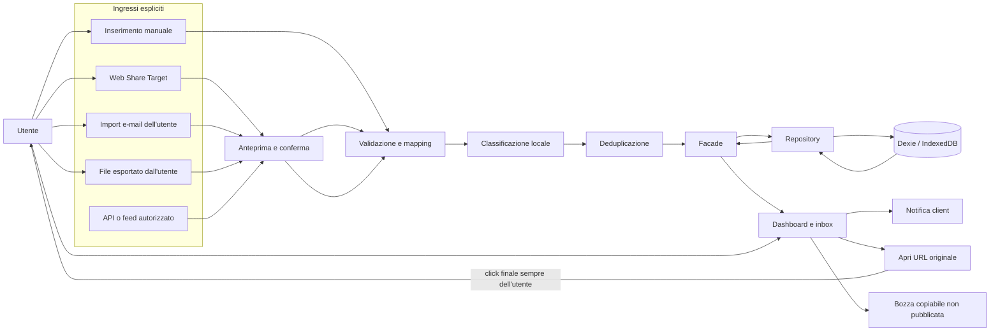

# Architettura MVP

## Decisioni di perimetro

Il primo rilascio è una PWA Angular installabile, client-side e single-user.
Dexie.js su IndexedDB fornisce persistenza locale e query senza richiedere
account, server o costi di hosting. La classificazione, i filtri e la
deduplicazione di base funzionano sul solo contenuto fornito dall'utente.

Le feature comunicano con la persistenza attraverso interfacce repository.
L'implementazione Dexie può essere sostituita da un adattatore HTTP senza
vincolare componenti e facade al database. NestJS, PostgreSQL, Prisma,
Supabase, autenticazione e Web Push server-side non fanno parte dell'MVP:
saranno valutati solo se un requisito concreto (ad esempio sincronizzazione
multi-dispositivo o push affidabile a PWA chiusa) li rende necessari.

### Flusso di acquisizione

1. L'utente inserisce un URL e i soli dettagli che desidera salvare, oppure
   condivide contenuto con la PWA, seleziona un file esportato o importa una
   e-mail ricevuta legittimamente.
2. L'app apre una schermata di anteprima/conferma per i flussi di condivisione
   e importazione; nessun contenuto viene recuperato dal sito dell'URL.
3. La facade valida i campi e coordina classificazione locale, deduplicazione
   e repository.
4. Il repository salva l'annuncio e una provenienza per ciascuna segnalazione,
   con timestamp di ricezione e origine.
5. La UI aggiorna dashboard e inbox. Le notifiche sono progressive: in MVP
   notifica in-app; le notifiche locali di sistema sono un'estensione del
   client. Web Push richiede un backend ed è successivo.
6. L'utente seleziona **Apri originale** per aprire il link. L'assistente
   prepara una bozza copiabile e indica chiaramente che non è stata pubblicata.

## Struttura Nx proposta

```text
regalo-radar/
├── apps/
│   └── web/                         # PWA Angular, routing e bootstrap
├── libs/
│   ├── shared/
│   │   ├── domain/                  # modelli, enum, regole pure
│   │   ├── ui/                      # componenti/accessibilità condivisi
│   │   └── util/                    # utility senza dipendenze feature
│   ├── data-access/
│   │   ├── listings/                # repository e adapter Dexie
│   │   ├── imports/                 # parser dei formati supportati
│   │   └── notifications/           # notifiche client
│   └── features/
│       ├── dashboard/
│       ├── inbox/
│       ├── listing-editor/
│       ├── share-intake/
│       ├── settings/
│       └── response-assistant/
├── docs/
│   ├── adr/
│   ├── architecture.md
│   └── backlog.md
├── nx.json
├── package.json
└── README.md
```

La struttura è intenzionalmente una proposta, non un workspace già generato.
Evitare librerie e livelli vuoti durante Step 2: creare una libreria quando il
codice condiviso o i confini di dipendenza ne giustificano l'esistenza.

## Confini frontend

- **Presentational UI:** componenti standalone, senza accesso diretto ai dati.
- **Feature components:** pagine e componenti di feature; Signals per lo stato
  locale e per la vista.
- **Facade:** orchestration della feature, stato reattivo e coordinamento dei
  casi d'uso; RxJS per flussi asincroni.
- **Services di dominio:** classificazione, normalizzazione, deduplicazione,
  template e policy di notifica, mantenuti testabili e indipendenti dalla UI.
- **Repository/data access:** interfacce di dominio e adapter Dexie; nessun
  componente dipende direttamente da IndexedDB.
- **Modelli e DTO:** tipi di dominio distinti dai record persistiti e dai
  payload d'importazione.
- **Configurazione runtime:** soglie, parole, quiet hours e preferenze
  modificabili dall'utente; nessun segreto nel bundle client.
- **Stili:** token CSS condivisi, temi chiaro/scuro e layout mobile-first.

In assenza di backend, "tempo reale" significa aggiornamento reattivo nella
sessione e sincronizzazione fra schede quando disponibile. Non promettere
consegna push con l'app chiusa né sincronizzazione remota.

## Diagramma



L'API/feed autorizzato è un confine architetturale per un'estensione futura,
non un connettore attivo nell'MVP. La freccia verso il sito originale non
rappresenta automazione dell'app.

## Dati e privacy nell'MVP

- Conservare URL originale, timestamp di ricezione e origine della segnalazione
  anche quando più segnalazioni confluiscono in un annuncio duplicato.
- Salvare titolo ed estratto solo se forniti dall'utente o inclusi nel contenuto
  che ha scelto di condividere/importare; evitare di acquisire il post completo.
- Non scaricare né analizzare pagine remote, immagini, profili o commenti.
- Conservare coordinate solo se inserite o fornite lecitamente e realmente
  necessarie; altrimenti usare il nome del comune.
- Consentire esportazione JSON, cancellazione e durata di conservazione
  configurabile prima di estendere l'MVP.
- L'hash e la similarità sono segnali di deduplicazione, non identificatori di
  persone; mantenere la provenienza di ogni record unito.

## Passaggio a backend

Quando necessario, introdurre un'app NestJS e un adapter API dietro le stesse
interfacce repository, con PostgreSQL/Prisma e una strategia di migrazione
esplicita. Prima di attivare account, sync o Web Push, definire modello di
minimizzazione, gestione delle chiavi/segreti lato server, CSRF, rate limiting,
retention, audit delle importazioni e comportamento offline.
